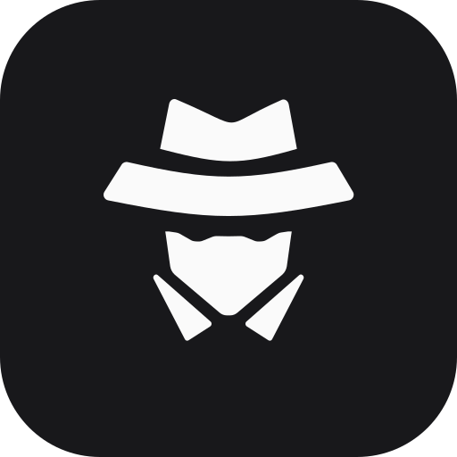
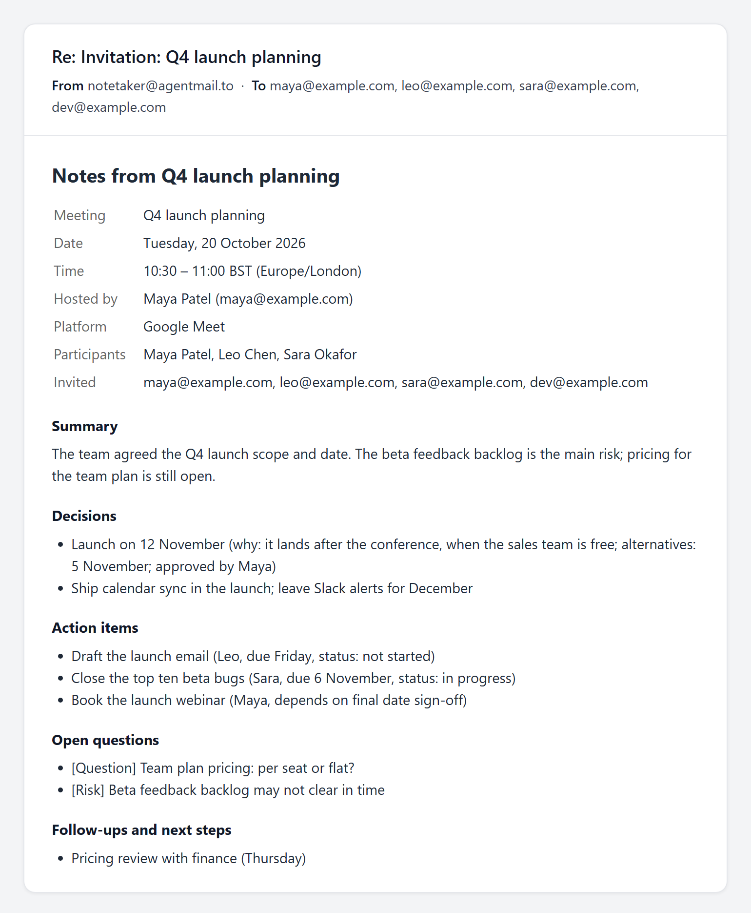

<div align="center">

<a href="https://agentmail.to"></a>
&nbsp;&nbsp;&nbsp;&nbsp;&nbsp;&nbsp;
<a href="https://meetstream.ai"></a>

# AgentMail + MeetStream

**Add it to your meeting invite. It joins the call and emails everyone the notes.**

[](https://github.com/meetstream-ai/agentmail-integration/actions/workflows/ci.yml)
[](#quickstart)
[](LICENSE)
[](https://agentmail.to)
[](https://meetstream.ai)

Zoom · Google Meet · Microsoft Teams · Google Calendar · Outlook

</div>

---

## Quickstart

Three keys: [AgentMail](https://console.agentmail.to), [MeetStream](https://app.meetstream.ai)
and [OpenAI](https://platform.openai.com/api-keys) (or [xAI](https://console.x.ai) for Grok). Then:

```bash
# 1. Install (Python 3.11+)
git clone https://github.com/meetstream-ai/agentmail-integration.git && cd agentmail-integration
python -m venv .venv && source .venv/bin/activate
pip install -r requirements.txt "./toolkit[example]"

# 2. Give the agent an inbox
export AGENTMAIL_API_KEY=am_...
python scripts/create_inbox.py my-notetaker          # prints my-notetaker@agentmail.to

# 3. Run it
export MEETSTREAM_API_KEY=ms_... OPENAI_API_KEY=sk-...
export AGENTMAIL_INBOX=my-notetaker@agentmail.to ALLOWED_SENDERS=you@gmail.com
python toolkit/examples/notetaker_agent.py

# 4. Invite my-notetaker@agentmail.to to a meeting
```

No tunnel, webhook or public URL needed: the example agent hears about new email over
AgentMail's WebSocket. Step-by-step version, including Windows:
[Try it in 10 minutes](#try-it-in-10-minutes).

---

## How it works

- [AgentMail](https://agentmail.to) gives the agent its own inbox: it receives the invite
  and sends the notes. That's the agent's asynchronous channel.
- [MeetStream](https://meetstream.ai) puts the agent in the call and transcribes it.
  That's the synchronous one.

```
 you: invite notetaker@agentmail.to
        │
        ▼
 AgentMail ── new email ──►  the agent  ── reads the invite: link, time, attendees
                                  │
                                  ▼
                    MeetStream: send a bot at the start time
                                  │      ... meeting happens ...
                    MeetStream ── transcript ready ──►  the agent
                                  │
                                  ▼
                    OpenAI, Grok or Gemini: transcript → meeting notes
                                  │
 everyone on the invite ◄── reply ──  AgentMail (same email thread)
```

## What you can build

| Use case | Start from | What you get |
|---|---|---|
| **Email-invite notetaker** | [`toolkit/examples/notetaker_agent.py`](toolkit/examples/notetaker_agent.py) | An AI agent that reads each invite, joins, and replies with the notes. No server needed |
| **Team notetaker server** | [`app/`](app/) | The same loop in plain code, behind webhooks, with retries and a safety net |
| **Calendar notetaker** | [`app/`](app/) → `/calendar` | Connect Google Calendar or Outlook; every meeting tagged `#notetaker` gets a bot |
| **Meetings for your own agent** | [`toolkit/`](toolkit/) | `agentmail-meetstream`: six meeting tools for the OpenAI Agents SDK or LangChain |
| **Your own integration** | [Integration guide](toolkit/docs/integrate-meetstream.md) | Build it into an existing agent, step by step |

## What the notes contain

<p align="center"></p>

Every notes email opens with the meeting's details. **Participants** are the people who
spoke, from the transcript; **Invited** is everyone on the invite. Then five sections:

- **Summary**: why the meeting happened, the key topics and the outcome
- **Decisions**: what was decided, why, the alternatives considered and who approved it
- **Action items**: the task, its owner, deadline, status and dependencies
- **Open questions**: unanswered questions, blockers, disagreements, risks and postponed decisions
- **Follow-ups and next steps**: upcoming meetings, milestones, promised deliverables, topics to revisit

The model is told to record only what was said: anything the call didn't state is left
out, and an empty section says "None recorded".

## Works with

- ✅ **Meetings:** Zoom, Google Meet and Microsoft Teams
- ✅ **Invites:** Google Calendar, Outlook and Zoom invite emails, one-off or recurring, including updates and cancellations
- ✅ **Calendars:** Google Calendar and Outlook / Microsoft 365, with a `#notetaker` opt-in
- ✅ **Notes models:** OpenAI, Grok or Gemini
- ✅ **Agent frameworks:** OpenAI Agents SDK and LangChain, alongside AgentMail's `agentmail-toolkit`
- ✅ **Access control:** only senders in `ALLOWED_SENDERS` can send the notetaker anywhere

---

## Try it in 10 minutes

The quickest way to see it work is the example agent. An AI model reads each invite,
joins the meeting and writes the notes itself.

**1. Get three keys**

| For | Where |
|---|---|
| The agent's inbox | [AgentMail console](https://console.agentmail.to): sign up, create an API key |
| Joining calls | [MeetStream dashboard](https://app.meetstream.ai): sign up, create an API key |
| Writing the notes | [OpenAI](https://platform.openai.com/api-keys), or [xAI](https://console.x.ai) for Grok |

**2. Install** (Python 3.11+)

```bash
git clone https://github.com/meetstream-ai/agentmail-integration.git
cd agentmail-integration
python -m venv .venv
```

```bash
# macOS / Linux
source .venv/bin/activate
```

```powershell
# Windows (PowerShell)
.venv\Scripts\Activate.ps1
```

```bash
pip install -r requirements.txt "./toolkit[example]"
```

**3. Create the agent's inbox**

```bash
export AGENTMAIL_API_KEY=am_...        # Windows PowerShell: $env:AGENTMAIL_API_KEY="am_..."
python scripts/create_inbox.py my-notetaker
```

It prints the address, e.g. `my-notetaker@agentmail.to`.

**4. Run the agent**

```bash
export MEETSTREAM_API_KEY=ms_...
export OPENAI_API_KEY=sk-...                     # or XAI_API_KEY=... for Grok
export AGENTMAIL_INBOX=my-notetaker@agentmail.to
export ALLOWED_SENDERS=you@gmail.com              # who it listens to: you
python toolkit/examples/notetaker_agent.py
```

On Windows PowerShell, set each one as `$env:NAME="value"` instead of `export`.

**5. Invite it to a meeting.** Create an event in Google Calendar or Outlook with a Meet,
Zoom or Teams link, add the agent's address as a guest and send the invite. It replies
"I'll join…", joins at the start time (admit it from the waiting room), and after the call
replies with the notes to everyone on the invite.

### If nothing happens

- **No reply at all:** your address isn't in `ALLOWED_SENDERS`. The agent ignores
  everyone else without answering, on purpose; the log says `ignoring mail from …`.
- **Google never emailed the agent:** check it's on the guest list, and choose **Send**
  when Google asks whether to email guests.
- **The bot never left the call:** someone else may still be in it. It leaves a minute
  after the last person does.
- **"No transcript could be made":** nobody spoke, or the mic was muted.

## What it handles

| Email the agent receives | What it does |
|---|---|
| Calendar invite (Google, Outlook, Zoom) | Schedules a bot for the start time, confirms to the sender |
| Updated invite (new time or link) | Reschedules the same bot |
| Cancellation | Cancels the bot, or takes it out of the call |
| Plain email with a Zoom / Meet / Teams link | Joins now |
| Invite from someone not in `ALLOWED_SENDERS` | Ignores it, no reply |
| Recurring invite | Joins every meeting in the series, with notes after each one |
| Change to one meeting of a series | Moves or skips just that meeting's bot |
| All-day event | Asks for a start time |

After the call, the notes go to the organizer and every attendee as a reply
in the invite's thread. If the bot can't get in (host denied it, meeting
locked), the sender hears about it.

## Run the reference app

The app in [`app/`](app/) does the same job with plain code instead of an AI agent
deciding, and adds the calendar route below. It's reached by webhooks, so it needs a
public HTTPS URL.

1. Install as in step 2 above, then `cp .env.example .env` (Windows: `copy .env.example .env`).
2. Fill in `.env`: the AgentMail key and inbox (step 3 above makes one), the MeetStream
   key, `LLM_PROVIDER` with its key (OpenAI, Grok or Gemini) and **`ALLOWED_SENDERS`**.
3. Give the server a public address. Locally, a tunnel:
   ```bash
   cloudflared tunnel --url http://localhost:8000     # or: ngrok http 8000
   ```
   Put the `https://…` address it prints in `.env` as `PUBLIC_BASE_URL`.
4. Point AgentMail at it. This prints the secret for `AGENTMAIL_WEBHOOK_SECRET`:
   ```bash
   python scripts/register_webhook.py
   ```
   A quick tunnel's address changes every time it starts; run this again when it does.
5. Start the server:
   ```bash
   uvicorn app.main:create_app --factory --port 8000
   ```

Then invite the agent to a meeting, as in step 5 above.

### Connect a Google or Outlook calendar

Instead of inviting the agent, connect a calendar at `http://localhost:8000/calendar`.
MeetStream keeps it in sync; every couple of minutes the app schedules a bot for upcoming
meetings tagged **`#notetaker`** (in the title or description), moves it when the meeting
moves, and calls it off when the meeting is cancelled or the tag removed. After the call
the notes are emailed to the attendees, and to the calendar's owner, from the agent's inbox.

The tag is deliberate: a work calendar is full of meetings whose attendees never asked
for a notetaker. Set `CALENDAR_TAG` empty to join everything.

Calendar sign-in runs through an OAuth app you register once with Google and/or Microsoft,
the same as for MeetStream's own calendar integration. The
[calendar setup guide](docs/calendar-setup.md) walks through both, step by step:

- **Google:** a Google Cloud OAuth client (type **Web application**), redirect URI
  `http://localhost:8000/calendar/callback`, read-only calendar scopes.
- **Outlook / Microsoft 365:** a Microsoft Entra app (platform **Web**), redirect URI
  `http://localhost:8000/calendar/outlook/callback`, open to work and personal accounts,
  with `Calendars.Read`. Teams links and Windows time zones are handled.

The calendar pages only answer requests made on the machine running the server. On a
hosted deployment, set `ADMIN_TOKEN` and sign in once at `https://your-host/calendar/login`;
the browser keeps a cookie after that.

### Deploy it

For a team, run the app on a host instead of a laptop and tunnel. The repo has a
Dockerfile and a `docker-compose.yml`:

```bash
docker compose up -d --build
```

The [deploy guide](docs/deploy.md) covers hosts (Render, Railway, Fly.io or a VM), the
settings to change, and pointing AgentMail at the new address.

## Give your own agent the tools

[`toolkit/`](toolkit/) packages the same abilities as tools for your own agent, for the
OpenAI Agents SDK and LangChain. Pair it with AgentMail's `agentmail-toolkit`; your agent
decides what to do with each email and writes the notes itself. See the guide,
[Integrate MeetStream](toolkit/docs/integrate-meetstream.md), and the
[toolkit README](toolkit/README.md).

## What's inside

```
app/                    ← Reference server: webhooks, calendar sync, notes, safety net
  main.py               ← Webhooks (AgentMail Svix-signed; MeetStream per-bot secret URL) and calendar pages
  flows.py              ← The loop: invite → bot → transcript → notes, calendar sync, safety net
  agentmail.py          ← Read a message, download its invite, reply or send
  meetstream.py         ← Schedule, reschedule, cancel a bot; transcripts; synced calendars
  notes.py              ← The notes prompt (OpenAI, Grok or Gemini) and the notes email
  calendar.py           ← Google and Microsoft sign-in; reading Google and Outlook events
  store.py              ← SQLite: invite ↔ bot ↔ email thread
scripts/                ← create_inbox.py, register_webhook.py
toolkit/                ← The agentmail-meetstream package (the AgentMail native plugin)
  src/agentmail_meetstream/   ← Tools, invite parser, OpenAI Agents SDK and LangChain adapters
  examples/notetaker_agent.py ← The agent from the Quickstart
  docs/integrate-meetstream.md
tests/                  ← The whole loop, with AgentMail, MeetStream and the models mocked
docs/deploy.md          ← Running the app on a host
docs/calendar-setup.md  ← Google and Microsoft sign-in, step by step
Dockerfile, docker-compose.yml
```

## Design notes

- **Webhooks are verified.** AgentMail signs with Svix; the server checks the
  raw body before reading it. MeetStream does not sign per-bot callbacks, so
  each bot's callback URL carries its own random token.
- **Every webhook may arrive twice.** AgentMail events are de-duplicated by id,
  and the notes are sent at most once per meeting.
- **Nothing is dropped quietly.** An email that fails to process is retried; notes
  that fail to write are retried by the safety net, and after three tries the
  sender is told.
- **Updates use the invite's UID and SEQUENCE.** That's how calendars mark a
  change to the same meeting, and an older update arriving late is ignored.
- **Webhooks can go missing.** Every 2 minutes the server asks MeetStream about
  bots that should have finished. If the transcript is ready it sends the notes;
  if none arrives within 15 minutes, it tells the sender instead of staying silent.
- **Only people you trust can reach the agent.** Each bot records other people and costs
  MeetStream minutes, so only addresses or domains in `ALLOWED_SENDERS` are answered;
  an empty list answers nobody. The example agent drops other mail before its model sees it.

## Development

```bash
pip install -r requirements-dev.txt "./toolkit[dev]"
ruff check . && ruff format --check .
mypy app scripts --ignore-missing-imports
pytest                       # the app
cd toolkit && pytest         # the toolkit
```

The tests mock AgentMail, MeetStream and the model APIs and run the whole loop, with no
keys needed. GitHub Actions runs all of the above on Python 3.11 and 3.12, and the toolkit
alone on 3.10, for every push and pull request. Working on the repo with an AI coding
agent? See [AGENTS.md](AGENTS.md). Changes are listed in [CHANGELOG.md](CHANGELOG.md).

Contributions are welcome: see [CONTRIBUTING.md](CONTRIBUTING.md). To report a security
issue, see [SECURITY.md](SECURITY.md).

## Links

- AgentMail: https://agentmail.to · [docs](https://docs.agentmail.to)
- MeetStream: https://meetstream.ai · [docs](https://docs.meetstream.ai)

## License

[MIT](LICENSE)
